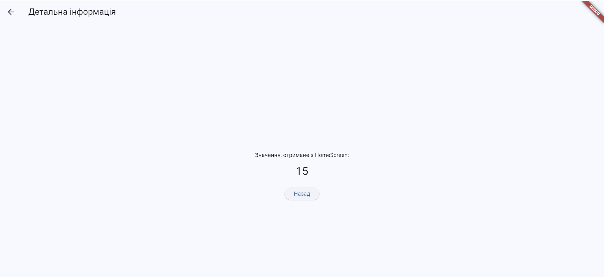

# Модульний контроль № 1
## Вступ до мобільної розробки

Навчальний проєкт, створений за допомогою Flutter та Dart для виконання практичних завдань із розробки мобільних застосунків.

## Мета проєкту

Закріпити основні навички програмування мовою Dart і створення інтерфейсів Flutter: роботу з класами та наслідуванням, створення віджетів, навігацію між екранами й асинхронні операції.

## Реалізовані завдання

### 1. Класи бібліотеки

Файл: `lib/models/library.dart`

Реалізовано:
- абстрактний клас `LibraryItem` із назвою, роком видання та методом `describe()`;
- клас `Book` з інформацією про автора;
- клас `Magazine` з номером випуску;
- клас `Library` для зберігання та пошуку видань;
- пошук видань за роком за допомогою `where()`;
- отримання описів за допомогою `map()`;
- пошук найстарішого видання з поверненням `null`, якщо бібліотека порожня.

Демонстраційний файл: `bin/library_demo.dart`.

Запуск:

```bash
dart run bin/library_demo.dart
```

### 2. Віджет рейтингу RatingBadge

Файл: `lib/widgets/rating_badge.dart`

Створено віджет `RatingBadge` на основі `StatelessWidget`.

Можливості:
- відображення рейтингу від 0 до 5;
- відображення зірочки та рейтингу з одним знаком після коми;
- необов'язкова текстова позначка;
- зелений колір для рейтингу від 4, оранжевий — від 2.5 до значення менше 4, червоний — для рейтингу нижче 2.5;
- використання `const`-конструктора.

### 3. Навігація між екранами

Файл: `lib/main.dart`

Реалізовано:
- головний екран `HomeScreen`;
- лічильник, який збільшується за допомогою `setState()`;
- перехід до `DetailScreen` через `Navigator.push()`;
- передавання поточного значення лічильника через конструктор;
- повернення на попередній екран за допомогою `Navigator.pop()`.

Глобальне сховище стану та Provider не використовуються.

Запуск застосунку у Chrome:

```bash
flutter run -d chrome
```

### 4. Асинхронний сервіс погоди

Файл: `lib/services/weather_service.dart`

Реалізовано клас `WeatherService` із такими методами:

- `fetchCurrentWeather(String city)` — асинхронно повертає дані про місто, температуру та погодні умови;
- `temperatureUpdates({int times = 5})` — передає значення температури через `Stream<int>`.

У реалізації використано `Future`, `Future.delayed()`, `async/await`, `async*`, `yield`, `await for` і обробку помилок через `try/catch`.

Дані про погоду генеруються локально для демонстрації асинхронної роботи. Реальний зовнішній погодний API не використовується.

Демонстраційний файл: `bin/weather_demo.dart`.

Запуск:

```bash
dart run bin/weather_demo.dart
```

## Структура проєкту

```text
module_control_1/
├── bin/
│   ├── library_demo.dart
│   └── weather_demo.dart
├── lib/
│   ├── main.dart
│   ├── models/
│   │   └── library.dart
│   ├── services/
│   │   └── weather_service.dart
│   └── widgets/
│       └── rating_badge.dart
├── test/
├── pubspec.yaml
└── README.md
```

## Технології

- **Flutter** — створення інтерфейсу застосунку.
- **Dart** — мова програмування.
- **Material Design** — компоненти інтерфейсу.
- **Git і GitHub** — контроль версій і зберігання вихідного коду.

## Перевірка проєкту

Для перевірки коду виконайте в корені проєкту:

```bash
flutter analyze
```

Скріншоти роботи

Скріншот 1


Скріншот 2

Для запуску демонстраційних програм використовуйте команди, наведені у відповідних розділах.

## Використання штучного інтелекту

Під час виконання роботи використовувався ChatGPT (OpenAI).

- **Мета використання:** отримання пояснень щодо Dart і Flutter, перевірка коду та оформлення документації.
- **Використані результати:** пояснення окремих частин коду, приклади реалізації класів бібліотеки, навігації між екранами й асинхронного сервісу погоди.
- **Власний внесок:** самостійне налаштування проєкту, написання демонстраційного коду для перевірки роботи класів бібліотеки та асинхронного сервісу погоди, аналіз запропонованих рішень, їх рефакторинг і часткова зміна відповідно до вимог модульного контролю, запуск програм, перевірка результатів та виправлення помилок.

## Репозиторій

GitHub: https://github.com/School-BD3/module_control_Daniil_1
